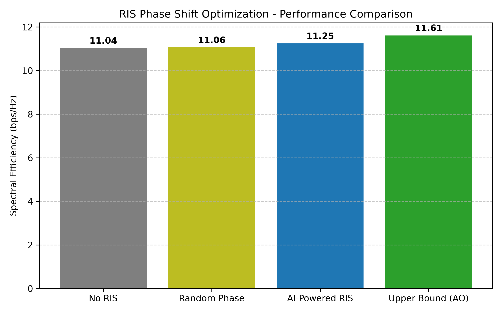

AI-Powered RIS Phase Shift Optimization for 6G Networks
An unsupervised deep-learning approach to configuring a Reconfigurable Intelligent Surface (RIS) in a MISO downlink. A small neural network maps the channel state directly to RIS phase shifts in a single forward pass, replacing an iterative Alternating Optimization (AO) solver.


---
Table of Contents
Overview
Key Features
System Model
Method
Project Structure
Installation
Usage
Results
Limitations
Roadmap
Author
Acknowledgement
---
Overview
An RIS is a passive surface made of many reflecting elements whose phase shifts can be tuned to steer a signal toward a user. Finding good phase shifts is a non-convex problem, and classical iterative solvers must be re-run whenever the channel changes. In 6G scenarios the channel can change within milliseconds, so solver run time is a practical bottleneck.
This project trains a neural network to predict the RIS phase shifts from the channel coefficients. The network is trained without labelled optimal phases: the spectral-efficiency formula is implemented as a differentiable PyTorch loss, so gradients flow from the achieved rate straight to the network weights.
Key Features
Realistic channel model. 3D geometry with distance-based path loss, Rician fading on the BS-RIS and RIS-user links, and Rayleigh fading on the direct link.
Label-free training. The network maximizes the average spectral efficiency directly, so it is not limited by the quality of a teacher algorithm.
Benchmark suite. Comparison against No-RIS, Random Phase and Alternating Optimization.
Hardware-aware evaluation. Predicted phases can be rounded to a discrete 2-bit grid to model practical metasurfaces.
Latency profiling. Per-channel run-time comparison between AO and network inference.
Gymnasium environment. A ready-to-use environment for reinforcement-learning agents (DDPG, TD3, PPO, SAC).
System Model
Single-cell downlink with an M-antenna base station (BS), an N-element RIS and one single-antenna user. The effective channel is
```
h\_eff = h\_d^H + h\_r^H · Θ · G,      Θ = diag(e^{jθ\_1}, ..., e^{jθ\_N})
```
Symbol	Meaning	Size
`h\_d`	BS → user (direct) channel	M × 1
`G`	BS → RIS channel	N × M
`h\_r`	RIS → user channel	N × 1
`θ\_n`	Phase shift of RIS element n, in [0, 2π)	N
With maximum-ratio transmission at the BS, the received SNR is `P\_t · ‖h\_eff‖² / σ²` and the objective is the spectral efficiency `log2(1 + SNR)` in bps/Hz.
Default simulation parameters
Parameter	Value
BS antennas (M) / RIS elements (N)	4 / 16
BS / RIS / user position (m)	(0, 0, 10) / (50, 10, 10) / (60, 0, 1.5)
Path-loss exponent (direct / RIS links)	3.5 / 2.2
Reference loss at 1 m	−30 dB
Fading	Direct: Rayleigh. BS-RIS and RIS-user: Rician, K = 3
Transmit power / noise power	30 dBm / −90 dBm
Method
Network (`RISPhaseNet`). A fully connected network with input `2(M + NM + N) = 168` features (real and imaginary parts of `h\_d`, `G`, `h\_r`, scaled by 10³), hidden layers of 256 and 128 units with BatchNorm and ReLU, and a sigmoid output layer of N units scaled by 2π.
Loss. `loss = −mean(log2(1 + P\_t · ‖h\_eff‖² / σ²))`, computed with batched complex tensor operations so that back-propagation reaches the predicted phases.
Training. Adam, learning rate 1e-3, batch size 64, 200 iterations, with a fresh batch of channel realizations at every iteration.
Baselines
Method	Description
No RIS	Direct path only
Random Phase	Phases drawn uniformly from [0, 2π)
Alternating Optimization	Coordinate ascent: each element is set to the phase that aligns its reflected signal with the sum of all others, repeated for 20 sweeps
Project Structure
```
.
├── channel\_model.py          # 3D geometry, path loss, Rayleigh/Rician channel generator
├── baselines.py              # No-RIS, Random Phase and Alternating Optimization solvers
├── environment.py            # Gymnasium environment for RL agents
├── train.py                  # Network, differentiable loss, training and evaluation
├── plots\_and\_benchmarks.py   # Transmit-power sweep, 2-bit quantization, latency analysis
├── ris\_model.pth             # Trained weights (generated by train.py)
├── benchmark\_results.png     # Method comparison figure (generated by train.py)
└── requirements.txt
```
Installation
```bash
git clone <your-repository-url>
cd <your-repository-folder>
pip install -r requirements.txt
```
Requirements: `numpy>=1.22`, `torch>=2.0`, `gymnasium>=0.28`, `matplotlib>=3.5`. A GPU is optional.
Usage
1. Train and evaluate
```bash
python train.py
```
Trains the network, saves `ris\_model.pth`, evaluates on 100 test channels and writes `benchmark\_results.png`.
2. Run the benchmark suite
```bash
python plots\_and\_benchmarks.py
```
Requires `ris\_model.pth`. Sweeps the transmit power from 10 to 35 dBm, evaluates the continuous and 2-bit quantized network against all baselines, reports per-channel run time and saves `power\_vs\_rate.png`.
3. Optional sanity checks
```bash
python channel\_model.py   # prints channel shapes and average powers
python baselines.py       # Monte Carlo comparison of the baselines (N = 32)
python environment.py     # runs one random step in the Gymnasium environment
```
Results
Average spectral efficiency over 100 test channels (M = 4, N = 16, P_t = 30 dBm):

Method	Spectral efficiency (bps/Hz)	Gain over No RIS	Share of AO
No RIS	11.04	–	95.1%
Random Phase	11.06	+0.02	95.3%
AI-Powered RIS (this work)	11.25	+0.21	96.9%
Alternating Optimization	11.61	+0.57	100%
The network reaches about 97% of the AO rate with a single forward pass, and clearly outperforms random phases, which add up incoherently and give no benefit over the direct link alone.
Inference latency (M = 4, N = 16)
Method	Time per channel	Speed-up vs. AO
Alternating Optimization	28.45 ms	1×
Neural network (CPU)	0.32 ms	~89×
Neural network (GPU)	0.08 ms	~350×
Latency depends on hardware and batching; run `plots\_and\_benchmarks.py` to reproduce the measurement on your machine.
Limitations
The direct path already gives roughly 34 dB SNR at 30 dBm, so absolute rates are high and the logarithm compresses the visible RIS gain. Lower-power or blocked-direct-link scenarios would show the RIS benefit more clearly.
AO is a coordinate-ascent heuristic, so it is a strong baseline rather than a proven upper bound.
The geometry is fixed, so the network is trained and tested on one BS/RIS/user placement.
Training is short (200 iterations) and there is no separate validation split, so the remaining gap to AO may shrink with longer training.
The benchmark script evaluates 2-bit quantization only.
Roadmap
[ ] Longer training with a validation set and learning-rate schedule
[ ] 1-bit quantization and quantization-aware training
[ ] Randomized user and RIS positions to test generalization across geometries
[ ] Scaling study for larger arrays (N = 64, 128) with CPU and GPU latency
[ ] Lower-power and blocked-direct-link scenarios
[ ] Comparison with RL agents using the Gymnasium environment
[ ] Multi-user MISO with sum-rate objective and imperfect CSI
Author
Arda Özgür
B.Sc. Computer Engineering, Mudanya University
Acknowledgement
This project was developed alongside insights gained from the University of Glasgow program 6G Vision: ML, Intelligent Surfaces & Optical Networks.
Credential ID: D4NFS910CO9Y
